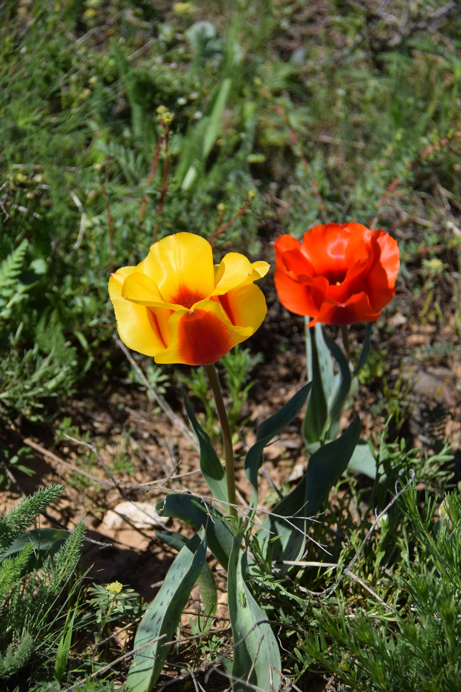
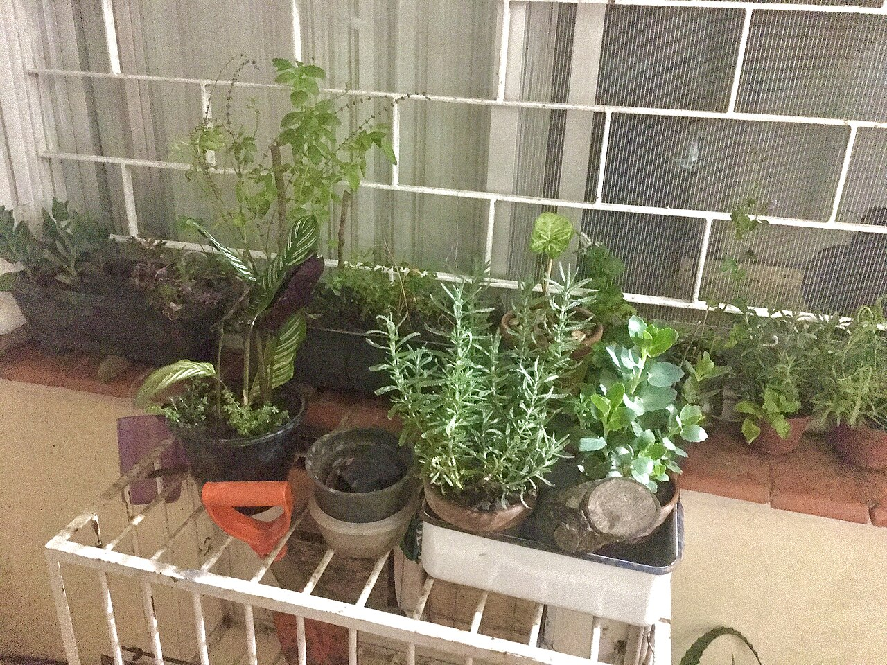
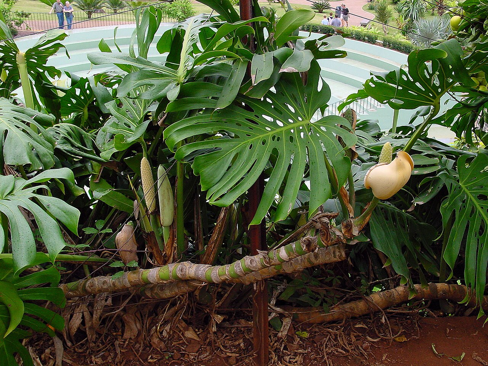

<div align="center">
  
  <h1>🌿 Qaragull</h1>
  <p><strong>Қазақстан флорасын танып, бақылап, зерттеуге арналған цифрлық дала дәптері.</strong></p>
  <p>
    <a href="https://qaragull-frontend.vercel.app/">🌐 Тікелей демо</a>
    &nbsp; · &nbsp;
    <a href="https://github.com/Jarv1s-stack/qaragull">💻 GitHub репозиторийі</a>
  </p>
  <p>
    
    
    
    
  </p>
</div>

<br />

> **Өсімдікке мұқият қарау — зерттеудің бастауы.** Qaragull суреттен өсімдік туралы бастапқы мәлімет алып, оны жеке бақылау журналы мен далалық атласқа байланыстырады.

<p align="center">
  
  
  
</p>

## 🗂️ Мазмұны

- [Жоба туралы](#-жоба-туралы)
- [Технологиялар мен дереккөздер](#-технологиялар-мен-дереккөздер)
- [Жергілікті іске қосу](#-жергілікті-ортада-іске-қосу)
- [Environment айнымалылары](#-environment-айнымалылары)
- [Vercel-ге орналастыру](#-vercel-ге-орналастыру)
- [Тексеру](#-тексеру-командалары)
- [Фото дереккөздері](#-readme-фотосуреттерінің-дереккөздері)

## 🌱 Жоба туралы

Qaragull — студенттерге, оқытушыларға, бағбандарға және табиғатты бақылаушыларға арналған қазақша веб-қосымша. Ол өсімдікті сурет арқылы тануды жеке күтім тарихымен, зертханалық құралдармен және Қазақстан табиғаты жөніндегі ашық бақылаулармен ұштастырады.

### Қолданбада бар мүмкіндіктер

| Бөлім | Не істей алады? |
| --- | --- |
| **AI сканері** | Камерамен түсіреді немесе сурет жүктейді; ықтимал өсімдік түрлерін, көрінетін белгілерді және қауіпсіз келесі қадамдарды көрсетеді. |
| **Түрді анықтау** | Pl@ntNet API кілті берілсе, үшке дейін ықтимал түр мен сәйкестік бағасын сұрайды. Кілт болмаса не сервис қолжетімсіз болса, OpenRouter vision моделіне ауысады. |
| **Белгілерді талдау** | OpenRouter суреттегі көрінетін симптомдарды сипаттап, ықтимал диагноз, күтім ұсынысы және нақтылау сұрағын жасайды. Нәтиже маманның диагнозын алмастырмайды. |
| **Сенімсіз нәтиже** | Модель түрге сенімді болмаса, оны күштеп анықтамай, «Белгісіз» деп көрсете алады. Суреттегі байқалған аймақты белгілейтін нәтиже де қолдау табады. |
| **Жеке жинақ** | Скан тарихын іздеу, сүзу, реттеу, CSV-ке шығару және қажет сканды өшіру мүмкіндігі бар. Жеке өсімдік профилі мен күтім оқиғаларын сақтайды. |
| **Зертхана** | Ауа райы, өсімдік өмірбаяны, Қазақстан флорасының картасы, сенсор журналы және күтім тәжірибелерін бір жерде ұсынады. |
| **Құрылғы және қолжетімділік** | Сенсор мәндерін демо ретінде көруге, үйлесімді браузерде Web Serial арқылы ESP32-ден CSV оқуға, қазақша/орысша браузер дауысын қолдануға болады. Офлайн анықтамалық браузер жадында сақталады. |

<details>
<summary><strong>Зертхана құралдары туралы нақтылау</strong></summary>

- Demo сенсорлары мен мини-жылыжай мәндері синтетикалық. Құрылғы қосылмайынша физикалық сорғы, шам немесе желдеткіш басқарылмайды.
- Web Serial үшін HTTPS және оны қолдайтын Chromium браузері қажет.
- Өсуге арналған 3D көрініс фотограмметриядан жасалмайды; параметрлер бойынша салынған жуық модель.
- Ауа райына байланысты күтім кеңесі эвристикалық. Ол топырақ ылғалының нақты өлшемі емес.
- Дауысты тану мен дауыстап оқу браузердің мүмкіндігіне тәуелді; бұл жеке AI API емес.

</details>

## 🧭 Жүйенің сызбасы

```mermaid
flowchart LR
    A[React + Vite веб-қосымшасы] --> B[Express API]
    B --> C[Pl@ntNet: өсімдік түрі]
    B --> D[OpenRouter: сурет талдауы]
    B --> E[Supabase: PostgreSQL және жабық Storage]
    A --> F[Open-Meteo: ауа райы]
    A --> G[iNaturalist API: ашық бақылаулар]
    A --> H[OpenStreetMap: карта қабаты]
```

## 🧰 Технологиялар мен дереккөздер

| Қабат | Технология / қызмет | Мақсаты |
| --- | --- | --- |
| Веб-интерфейс | React, Vite, React Router | Беттер мен навигация |
| Сервер | Node.js, Express | Кіру, скан, профиль және зертхана API-лері |
| Дерекқор және файлдар | Supabase PostgreSQL, Supabase Storage | Аккаунт, журнал, өлшем және жеке сурет сақтау |
| Өсімдікті тану | [Pl@ntNet API](https://docs.plantnet.org/en/reference/api-plantnet/), қосымша кілтпен | Арнайы өсімдік сәйкестендіруі; тегін квота API шартына тәуелді |
| Көру арқылы талдау | [OpenRouter](https://openrouter.ai/) vision API | Gemma 4 негізгі модель, Nemotron 3.5 Super VL қосалқы модель, соңғы fallback ретінде `openrouter/free` бағыты |
| Карта | Leaflet, [OpenStreetMap](https://www.openstreetmap.org/copyright) | Қазақстандағы бақылауларды картаға түсіру |
| Ауа райы | [Open-Meteo API](https://open-meteo.com/en/license) | Ағымдағы ауа райы мен болжам |
| Ашық бақылаулар | [iNaturalist API](https://www.inaturalist.org/api) | Қоғамдық табиғат бақылаулары |
| Көрнекі кітапханалар | Three.js, Lucide React, Axios | 3D көрініс, белгішелер және HTTP сұраулары |
| Орналастыру | Vercel | Frontend пен Express API хостингі |

**Жеке үйретілген AI моделі немесе арнайы таңбаланған Qaragull деректер жиыны жоқ.** Жоба өсімдікті тану және сурет талдау үшін сыртқы API қызметтерін пайдаланады. Экрандағы AI сенімділік бағасы тәуелсіз ботаник мамандар тексерген фотолар жиынында өлшенген дәлдік емес.

### Дерек, лицензия және қауіпсіздік

- Open-Meteo дерегін қолданғанда **CC BY 4.0** атрибуциясы беріледі.
- OpenStreetMap картасына авторлық атрибуция қажет; дерек **ODbL** шартымен беріледі.
- iNaturalist жазбалары мен суреттерінің лицензиясы әр жазбада әртүрлі болуы мүмкін. Деректі қайта қолданғанда нақты жазба лицензиясын тексеріңіз.
- PlantNet-тің тегін API лимиті мен атрибуция шарты өзгеруі мүмкін. Қолданар алдында [ресми API шартын](https://my.plantnet.org/terms_of_use) қараңыз.
- Скан суреті Pl@ntNet немесе OpenRouter-ге жіберілуі мүмкін. Сурет Supabase-тағы **жабық Storage bucket-те** сақталады; интерфейстегі уақытша сілтеме 24 сағатқа жарамды.
- Қауымдастыққа бақылау жіберу ерікті әрі нақты келісімді қажет етеді. Координат жуық торға дөңгелектенеді. Картада ықтимал ауру ошағы соңғы 30 күнде бір тор ұяшығында кемінде үш ұқсас бақылау болғанда ғана көрінеді.
- AI нәтижесін ақпараттық көмек ретінде ғана қабылдаңыз. Оны түрді ғылыми растау, ауруды нақты анықтау немесе маман кеңесін алмастыру үшін қолданбаңыз.

## 🚀 Жергілікті ортада іске қосу

### Қажетті құралдар

- Node.js **20.19 немесе одан жоғары**
- npm
- Supabase жобасы
- OpenRouter API кілті. Pl@ntNet кілті түрді арнайы тану үшін қосымша.

### 1. Репозиторийді жүктеу

```powershell
git clone https://github.com/Jarv1s-stack/qaragull.git
cd qaragull
```

### 2. Supabase жобасын дайындау

1. Supabase-та жоба ашыңыз.
2. **SQL Editor** ішінде `final_back/supabase/schema.sql` файлының мазмұнын бір рет орындаңыз.
3. Dashboard ішінен Project URL және серверлік `secret` кілтін алыңыз. Secret кілтті тек backend `.env` файлына енгізіңіз.
4. Email арқылы тіркелуді тексеру үшін Supabase → **Authentication → Email Templates → Confirm signup** үлгісінде `{{ .Token }}` коды бар екенін тексеріңіз.

### 3. Backend орнату

Жоба түбірінен:

```powershell
cd final_back
Copy-Item .env.example .env
npm ci
```

`final_back/.env` ішінде мына мәндерді толтырыңыз:

```dotenv
SUPABASE_URL=https://<project-ref>.supabase.co
SUPABASE_SECRET_KEY=<server-side-secret-key>
SUPABASE_STORAGE_BUCKET=plant-images
OPENROUTER_API_KEY=<openrouter-key>
JWT_SECRET=<кемінде-32-таңбалы-кездейсоқ-құпия>
CLIENT_URL=http://localhost:5173
AUTH_REDIRECT_URL=http://localhost:5173/login?confirmed=1
OPENROUTER_SITE_URL=http://localhost:5173
```

Қосымша түр тану үшін:

```dotenv
PLANTNET_API_KEY=<plantnet-api-key>
```

`OPENROUTER_MODEL` мен fallback мәндері `.env.example` ішінде алдын ала көрсетілген. Дерекқор кестелерін және жабық Storage bucket-ті тексеріп, дайындаңыз:

```powershell
npm run db:setup
npm run dev
```

Backend әдепкіде `http://localhost:5002` адресінде жұмыс істейді.

> `npm run db:setup` кестелерді өзі SQL арқылы жасамайды. Алдымен `schema.sql` файлын Supabase SQL Editor-де орындаңыз.

### 4. Frontend орнату

Жаңа терминалда жоба түбірінен:

```powershell
cd qaragull
Copy-Item .env.example .env
npm ci
npm run dev
```

Frontend-ті `http://localhost:5173` адресінен ашыңыз. `.env.example` ішіндегі `VITE_API_URL=/api` мәні Vite арқылы backend-тің `localhost:5002` адресіне проксиленеді.

## 🔐 Environment айнымалылары

Backend пен frontend-ке бөлек `.env` файл керек:

| Файл | Негізгі айнымалылар |
| --- | --- |
| `final_back/.env` | `SUPABASE_URL`, `SUPABASE_SECRET_KEY`, `OPENROUTER_API_KEY`, `JWT_SECRET`, `CLIENT_URL`, `AUTH_REDIRECT_URL`, `OPENROUTER_SITE_URL` |
| `qaragull/.env` | `VITE_API_URL` |
| Backend optional | `PLANTNET_API_KEY`, `SUPABASE_STORAGE_BUCKET`, `OPENROUTER_MODEL`, `OPENROUTER_FALLBACK_MODEL` |

`.gitignore` `.env` файлдарын өткізіп жібереді. API кілттерін, Supabase secret key-ді немесе JWT құпиясын репозиторийге, frontend-ке және `VITE_` айнымалысына салмаңыз. Үлгі үшін тек `.env.example` файлдарын жариялаңыз.

Тіркелу email растау сілтемесін жібереді; код енгізу қажет емес. Жергіліктіде redirect `http://localhost:5173/login?confirmed=1`, ал жарияланған backend үшін `AUTH_REDIRECT_URL=https://qaragull-frontend.vercel.app/login?confirmed=1` орнатыңыз. Бұл URL-ді Supabase Dashboard → **Authentication → URL Configuration → Redirect URLs** тізіміне де қосыңыз. **Site URL** мәнін сайт доменіне қойыңыз.

Supabase әдепкі пошта қызметімен хаттарды шектеулі түрде ғана жібереді (негізінен ұйым командасының расталған адрестеріне). Басқа қолданушыларға email жіберу үшін Dashboard ішіндегі **Authentication → SMTP Settings** бөлімінде нақты SMTP жеткізушісін баптау қажет. SMTP мәліметтері бос болса, растау хаты жеткізілмейді.

## ☁️ Vercel-ге орналастыру

Vercel ішінде бір репозиторийден екі жоба жасаңыз:

| Жоба | Root Directory | Build / Framework |
| --- | --- | --- |
| Frontend | `qaragull` | Vite · `npm run build` · `dist` |
| Backend | `final_back` | Express · `vercel.json` параметрлерін қолданыңыз |

Backend жобасының **Production** және **Preview** ортасына Supabase пен AI құпияларын, `JWT_SECRET`, `CLIENT_URL`, `AUTH_REDIRECT_URL` және `OPENROUTER_SITE_URL` қосыңыз. `AUTH_REDIRECT_URL` ретінде `https://qaragull-frontend.vercel.app/login?confirmed=1` орнатыңыз. Supabase Auth Redirect URLs ішінде осы URL-ге рұқсат беріңіз. Frontend Vercel жобасында тек мына API адресін орнатыңыз:

```dotenv
VITE_API_URL=https://<backend-project>.vercel.app/api
```

Frontend-ті қайта жариялағаннан кейін backend-тегі `CLIENT_URL` мәнін нақты frontend доменіне сәйкестендіріңіз. Құпия айнымалыларды Vercel Environment Variables ішінде сақтаңыз.

## 🧪 Тексеру командалары

```powershell
# Frontend құрастыруын тексеру
cd qaragull
npm run build
npm run lint

# Backend-ті тексеру
cd ..\final_back
npm run db:setup
npm run dev
```

Backend күйі: `http://localhost:5002/api/health`

## 📷 README фотосуреттерінің дереккөздері

- **Грейг қызғалдағы**, V.A. Kovshar — [Wikimedia Commons](https://commons.wikimedia.org/wiki/File:Tulipa_greigii_(Aksu_Zhabagly_Nature_Reserve,_Kazakhstan).png), **CC BY-SA 4.0**.
- **Plant seedlings**, Heylenny — [Wikimedia Commons](https://commons.wikimedia.org/wiki/File:Plant_seedlings.jpg), **CC BY-SA 4.0**.
- **Monstera deliciosa A**, Lijealso — [Wikimedia Commons](https://commons.wikimedia.org/wiki/File:Monstera_deliciosa_A.jpg), **Public Domain**.

Осы суреттер `docs/images/` ішіне README-де көрсету үшін қосылған. Қолданбаның басқа деректері мен сыртқы API-лерінің шарттары өз алдына қолданылады.

> Репозиторий түбірінде ортақ код лицензиясын анықтайтын `LICENSE` файлы жоқ. Кодты қайта пайдаланар алдында автордан лицензия шартын нақтылаңыз.

<div align="center">
  <sub>🌿 Qaragull · Қазақстан флорасын бірге бақылауға арналған цифрлық далалық дәптер</sub>
</div>
